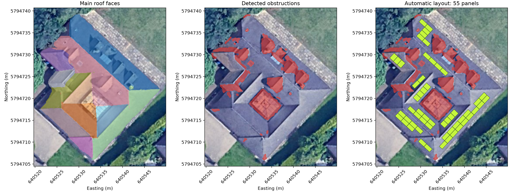
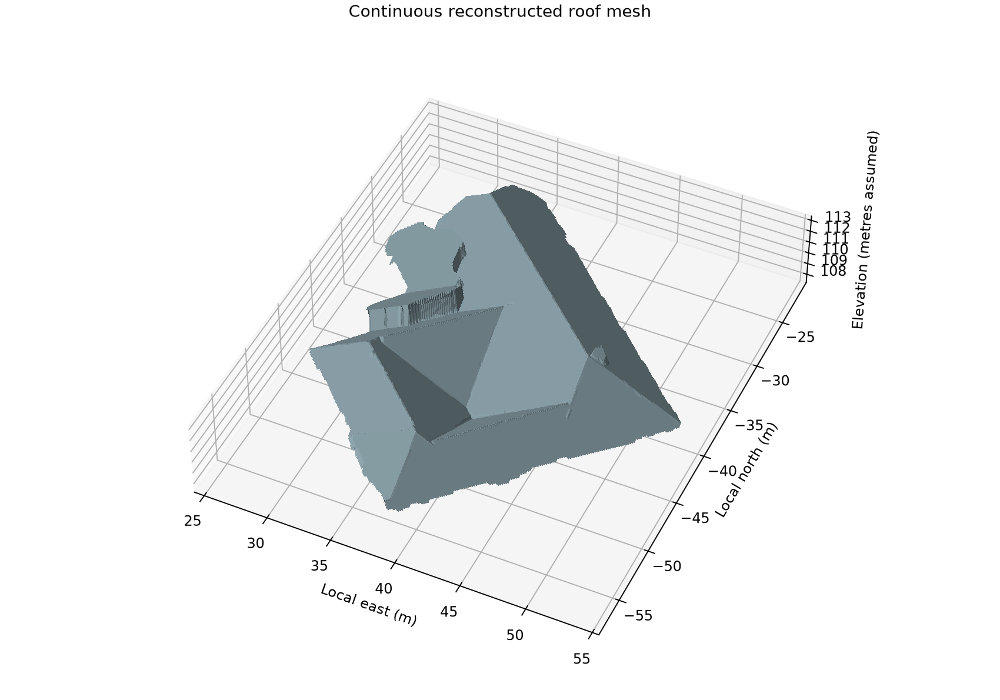
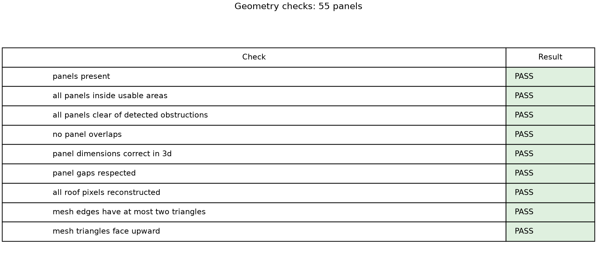

# 3D Roof Reconstruction and Solar Panel Placement

[Watch the video demonstration](https://drive.google.com/file/d/1g29jvZYRLYrVtTgtgJtf5z0BVg2t76mu/view?usp=sharing)

I built this workflow for the Your Power Labs technical assessment. I used DSM
elevations to reconstruct the roof and RGB imagery to help separate vegetation
and rooftop obstructions. I then placed solar panels on the sloping roof faces,
using their actual dimensions and allowing space around roof edges and obstructions.

## Final results

| Measure | Result |
| --- | --- |
| Refined roof plan area | 493.21 m² |
| Main supporting roof regions | 11 |
| Detected obstruction plan area | 99.52 m² |
| Panels placed | 55 |
| Total panel surface area | 109.90 m² |
| Surface-to-DSM RMSE outside detected obstructions | 0.079 m |
| Geometry checks | 9 of 9 pass |

Roof plan area is measured horizontally; panel area is measured on the sloping
faces. The RMSE shows agreement with the input DSM, rather than accuracy against
an independent survey. I completed visual QA/QC of the submitted results.

### Roof faces, obstructions and panel layout



Red areas show detected obstructions. The lime-green rectangles show the panels.

### Reconstructed roof



[Download the interactive 3D model](results/roof_3d.html) and open it in a browser
to rotate the roof and inspect the panels and obstructions. The HTML file includes
Plotly and works offline.

### Geometry checks



The checks cover panel presence, containment within usable areas, avoidance of
detected obstructions, overlap, 3D panel dimensions, panel gaps, reconstructed
elevations, mesh-edge incidence and triangle orientation.

## How I approached the problem

1. **Check the inputs.** I checked the raster grids, CRS and pixel size before
   combining the DSM and RGB data. The clipped DSM defines the property area.
   The supplied data use EPSG:32630 and 0.10 m pixels.

2. **Identify the roof.** I estimated a low ground reference from the 10th
   percentile of valid property elevations. Height above that reference and the
   RGB green index, `(2G - R - B) / (R + G + B + 1)`, help separate the roof
   from low surfaces and vegetation. I cleaned the mask and kept the largest
   connected region.

3. **Calculate slope and aspect.** I used a one-pixel Gaussian filter before
   calculating the east-west and north-south elevation gradients. Slope comes
   from the gradient magnitude. Downhill aspect is measured clockwise from
   grid north.

4. **Identify and fit roof faces.** I grouped four-connected pixels with similar
   aspect, then fitted `z = ax + by + c` using iteratively trimmed least squares.
   Rejecting elevation outliers reduced their influence on the fitted planes.
   The initial 20 faces were reduced to 11 main supporting regions using the
   area and slope filter below.

5. **Reconstruct the roof and detect obstructions.** Plane predictions provide
   regularized elevations and support reconstruction of internal gaps. I compared
   the DSM with the predicted roof and combined height differences with blue-colour
   and compact-brightness cues to flag obstructions. Shared mesh vertices connect
   neighbouring faces into a continuous height-field surface.

6. **Place the panels.** I transformed each roof face into coordinates on its
   sloping plane, applied clearances and tested portrait and landscape grids
   with shifted starting positions. I kept a compact connected panel group on
   each face, then checked the resulting geometry.

## Main assumptions

| Setting | Value used |
| --- | --- |
| Ground reference | 10th percentile of valid elevations inside the property |
| Minimum height above ground reference | 2 m |
| Green-index cutoff | 0.03 |
| Initial face seeds | At least 3 m²; 45° aspect sectors |
| Maximum distance from initial face support | 0.6 m |
| Main supporting regions | At least 10 m²; slope 25°–55° |
| Obstruction height test | Absolute DSM-to-plane difference greater than 0.30 m |
| Blue contrast | `(B - R) / (B + R + 1) > 0.26`, with additional colour tests |
| Panel dimensions | 1.762 × 1.134 m |
| Panel gap | 0.02 m |
| Roof-edge and obstruction clearance | 0.35 m each |
| Minimum connected panel group | 2 panels |

I used the dimensions of the
[JA Solar JAM54D40 LB module](https://www.jasolar.eu/fileadmin/data/4.0/JAM54D40_LB/2024/JAM54D40_LB.pdf).
This is the selected module size, not a universal size for all solar panels.
The clearances are assumptions for this assessment. Additional image and
component-shape thresholds are explicit in the code.

## Setup and run

I ran the final notebook on Windows with Python 3.11.17. The six core library
versions in `requirements.txt` match the versions imported by that environment.

In Anaconda Prompt:

```bat
git clone https://github.com/hayatkhan20/YPL.git
cd YPL
conda create -n ypl python=3.11 -y
conda activate ypl
set "PYTHONNOUSERSITE=1"
python -m pip install -r requirements.txt
python -m ipykernel install --user --name ypl --display-name "Python (YPL)" --env PYTHONNOUSERSITE 1
```

If a working `ypl` environment already exists, skip the environment-creation step.

Place the separately supplied assessment rasters in the `Data` folder:

- `rgb.tif`
- `dsm_full.tif`
- `dsm_clipped.tif`

Then open the notebook:

```bat
cd Working
python -m notebook
```

Open [Roof_Analysis_Final.ipynb](Working/Roof_Analysis_Final.ipynb), select
**Python (YPL)** and run the cells from top to bottom.

The same code is available as [roof_analysis.py](Working/roof_analysis.py).
To run it as a script, stay inside `Working` and use:

```bat
python roof_analysis.py
```

Close each plot window to continue when running the script.

Each run saves outputs in a new `~/YPL_outputs/run_<timestamp>` folder and prints
the full path. The [results folder](results) contains the submitted run's images,
GeoTIFFs, GeoJSONs, plane CSV, OBJ mesh, HTML model and
[numerical summary](results/summary.json).

## Limitations and QA/QC

- Algorithm outputs require human QA/QC, particularly for roof boundaries and
  obstruction detections. Height and colour cues can miss objects or flag roof
  details incorrectly.
- The ground reference is approximate. It does not mean that the lowest 10% of
  pixels have been confirmed as ground.
- DSM vertical units are assumed to be metres; the vertical datum is unconfirmed.
- The 10 m² and 25°–55° support filter is a simplifying choice for this dataset.
  It can exclude genuine small, shallow or steep roof sections.
- Shared vertices give approximate ridge joins. This is a continuous roof
  surface, not an exact CAD model or a closed building solid.
- This roof had **zero missing elevation pixels**. The reconstruction method
  supports internal gaps, but that capability was not demonstrated on actual
  missing roof data here.
- Passing geometry checks validate the generated model and detected masks.
  They do not independently verify the roof or obstruction detections.


